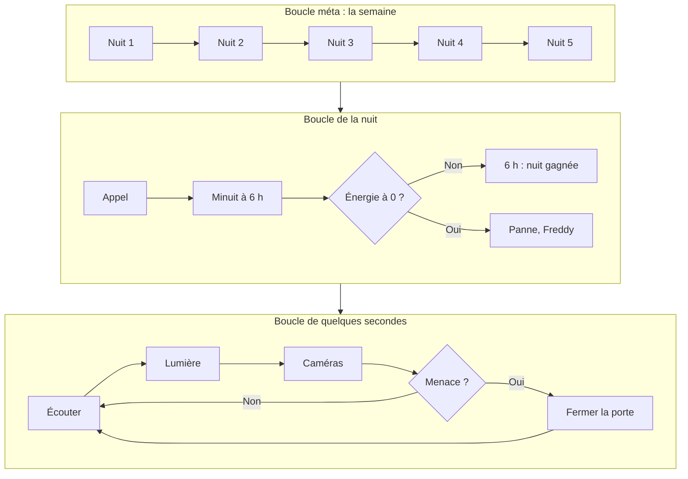
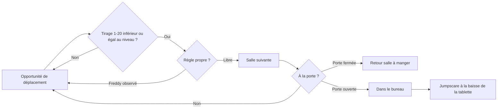
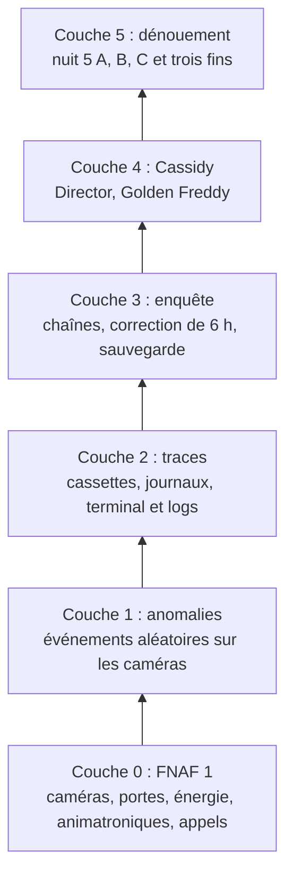

# Origine : FNAF 1 et sa réinterprétation

Point de départ du projet. Ce document explique comment fonctionne le Five Nights at Freddy's 1 d'origine côté code, quelles boucles de jeu il crée, puis comment le remake le reprend et ce qu'il y ajoute, couche par couche.

Rédigé le 18/11/2026. Remplace les trois notes de reconstruction rangées dans `archives/` (`game.md`, `ia.md`, `batterie.md`), qui contiennent des valeurs fausses (tables de probabilité par heure, coûts d'énergie) : elles ne servent plus de référence.

---

## 1. FNAF 1 côté code

FNAF 1 est fait sous Clickteam Fusion. Il n'y a pas d'intelligence artificielle au sens moderne : chaque animatronique est un compteur de position, un niveau d'IA et un tirage au sort à intervalle fixe. Tout le reste est de la mise en scène.

### Le tirage de déplacement

Chaque animatronique a une « opportunité de déplacement » à intervalle fixe :

| Animatronique | Intervalle |
| --- | --- |
| Freddy | 3,02 s |
| Bonnie | 4,97 s |
| Chica | 4,98 s |
| Foxy | 5,01 s |

À chaque opportunité, le jeu tire un nombre de 1 à 20. Si le niveau d'IA est supérieur ou égal au tirage, l'animatronique bouge. Un niveau 0 ne bouge jamais, un niveau 20 bouge à chaque fois.

### Niveaux d'IA

Niveau de départ de chaque nuit (de 0 à 20) :

| Nuit | Freddy | Bonnie | Chica | Foxy |
| --- | --- | --- | --- | --- |
| 1 | 0 | 0 | 0 | 0 |
| 2 | 0 | 3 | 1 | 1 |
| 3 | 1 | 0 | 5 | 2 |
| 4 | 1 ou 2 (une chance sur deux) | 2 | 4 | 6 |
| 5 | 3 | 5 | 7 | 5 |
| 6 | 4 | 10 | 12 | 16 |

Pendant la nuit : Bonnie gagne +1 à 2 h, 3 h et 4 h ; Chica et Foxy +1 à 3 h et 4 h ; Freddy ne change pas. La nuit 1 n'est donc pas vide : Bonnie, Chica et Foxy se réveillent vers 3 h.

### Le temps

Une heure de jeu dure environ 89 secondes : une nuit complète (minuit à 6 h) fait un peu moins de 9 minutes. 6 h gagne immédiatement, même en pleine attaque.

### Bonnie et Chica

- Bonnie passe par le côté gauche : scène (1A), salle à manger (1B), coulisses (5), couloir ouest (2A), placard (3), coin ouest (2B), porte gauche. Son chemin n'est pas une ligne : il saute entre ces salles.
- Chica passe par le côté droit : scène, salle à manger, toilettes (7), cuisine (6, son seulement), couloir est (4A), coin est (4B), porte droite.
- Ils bougent même si le joueur les regarde. La caméra qu'ils quittent grésille et se coupe un instant.
- À la porte : si la porte est fermée à leur prochain déplacement réussi, ils repartent vers la salle à manger. Si elle est ouverte, ils entrent dans le bureau, les boutons de porte et de lumière cessent de répondre, et l'attaque arrive quand le joueur baisse la tablette.

### Freddy

- Chemin : scène, salle à manger, toilettes, cuisine, couloir est, coin est (4B), bureau.
- Il ne quitte pas une salle tant que le joueur le regarde sur la caméra. Une opportunité réussie lance un compte à rebours avant le déplacement réel.
- Depuis le coin est, il entre dans le bureau si la porte droite est ouverte, que la tablette est levée et qu'elle ne montre pas la caméra 4B.
- Son rire et la boîte à musique sont ses seuls avertissements quand il avance.

### Foxy

- Phases dans Pirate Cove (1C) : rideau fermé, tête qui dépasse, sorti du rideau, cove vide.
- Regarder les caméras bloque sa progression pendant une durée aléatoire. Les laisser baissées longtemps le fait avancer.
- Cove vide : il court par le couloir ouest (2A). Si la porte gauche est fermée, il cogne, retourne à la cove et coûte de l'énergie (1 % la première fois, puis 5 % de plus à chaque fois, valeurs à confirmer). Si elle est ouverte, jumpscare.

### Énergie

- 100 % au début de la nuit. Usage de 1 à 5 barres : 1 au repos, +1 pour chaque porte fermée, chaque lumière allumée et la tablette levée.
- Au repos, l'énergie baisse d'environ 1 % toutes les 9,6 secondes en nuit 1. Chaque barre accélère la baisse. À partir de la nuit 2, une perte passive supplémentaire s'ajoute et devient plus rapide chaque nuit. Les valeurs exactes varient selon les sources : à vérifier avant de s'en servir.
- Panne : tout s'éteint, les portes s'ouvrent. Freddy apparaît à la porte gauche avec la Marche du Toréador, puis le noir, puis l'attaque. Chaque étape a une durée aléatoire : 6 h peut arriver avant.

### Golden Freddy

Rare. L'affiche de la caméra 2B change ; en baissant la tablette, Golden Freddy est assis dans le bureau. Relever la tablette le fait disparaître. Le regarder trop longtemps : jumpscare, puis le jeu se ferme.

### Les appels

Le Phone Guy appelle au début des nuits 1 à 5. Le joueur peut couper l'appel. L'appel de la nuit 5 est un enregistrement inversé.

## 2. Les boucles de gameplay

FNAF 1 tient sur trois boucles imbriquées.

- Boucle courte : vérifier, décider, payer. Chaque vérification coûte de l'énergie, chaque protection aussi. Il n'y a pas de bonne réponse, seulement un compromis.
- Boucle de la nuit : un compte à rebours (l'heure) contre une réserve qui s'épuise (l'énergie). La difficulté monte toute seule à 2, 3 et 4 h.
- Boucle de la semaine : niveaux d'IA plus hauts chaque nuit, et l'histoire racontée par les appels et les coupures de presse.

Ce qui fait peur ne vient pas des règles mais de ce que le joueur ne voit pas : la caméra est le seul moyen de savoir, et chaque regard est une dépense. Freddy rend les caméras suspectes, Foxy punit ceux qui ne regardent pas.

## 3. Le remake : comment le code reprend FNAF 1

Le remake garde la structure (salles, caméras, portes, lumières, énergie, quatre animatroniques, appels) mais pas le moteur interne. Correspondances :

| FNAF 1 | Remake | Fichiers |
| --- | --- | --- |
| Boucle Clickteam | `setInterval(gameLoop, 1000 / 60)` : énergie, ambiance, caméra, horloge | `script/app/game_loop.js`, `script/mechanics/night.js` |
| Heure de 89 s | 1 minute de jeu = 120 ticks = 2 s ; 1 heure = 120 s ; nuit de 12 min | `script/state/game_state.js` |
| Opportunité + tirage 1-20 | Un tour toutes les 5 minutes de jeu (10 s) ; déplacement tous les `20 - 2 × niveau` tours, sans tirage | `script/mechanics/animatronic.js` (`move`) |
| Niveaux par nuit et par heure | Une table par nuit, sans montée horaire | `script/state/game_config.json` (`nightAiLevels`) |
| Arrivée à la porte, entrée dans le bureau | « Safe room » : un compteur d'attaque par minute, coups à la porte (30 %), attaque si la porte est ouverte au seuil, sinon nouveau seuil aléatoire | `animatronic.js` (`attack`) |
| Foxy | Machine à phases (inactif, tête sortie, prêt, course, retrait) avec une agressivité calibrée pour une première course à 6, 5, 4, 3, 2 minutes selon la nuit | `script/mechanics/foxy.js` |
| Énergie | Mêmes barres d'usage, table de perte par seconde (0,09 à 0,9 %), sans perte passive par nuit | `script/mechanics/power.js`, `game_config.json` (`powerSystem`) |
| Panne | Transition vers la séquence de Freddy | `transitionEndNightFreddy()` |
| Appels | Appels 1 à 4 d'origine ; appel 5 remplacé par Cassidy (A, B, C) | `night.js` |

Écarts connus avec FNAF 1, à faire auditer (agent `auditeur-fnaf1`) avant de les corriger ou de les assumer :

- Pas de tirage au sort pour les déplacements : le rythme est régulier et prévisible.
- Table des niveaux d'IA différente de l'original (nuit 1 active dès minuit, pas de montée horaire).
- Nuit de 12 minutes au lieu d'environ 9.
- Chemins simplifiés et linéaires (Freddy saute les toilettes et la cuisine, Bonnie suit une ligne).
- Freddy : le code ne le fait avancer que tablette levée ; dans l'original, c'est le regard sur sa caméra qui le bloque. Règle à vérifier.
- Énergie : pas de perte passive croissante par nuit.

## 4. La réinterprétation : les sous-couches

Le remake empile des couches au-dessus de FNAF 1. La couche 0 reste fidèle à l'original (règle du projet) ; les autres sont du contenu original et ne touchent pas aux règles de survie.

| Couche | Ce qu'elle ajoute | Lien avec FNAF 1 | État |
| --- | --- | --- | --- |
| 0. FNAF 1 | La survie | L'original | Codé |
| 1. Anomalies | Des détails qui changent sur les caméras : une chaise, un dessin, une gamelle, une petite voiture | Réutilise la caméra, seul moyen de savoir : regarder devient aussi enquêter | Codé (`script/core/random_events_engine.js`) |
| 2. Traces | Ce qu'une anomalie rapporte : cassettes, journaux, logs du terminal | Prolonge les coupures de presse et les appels : le récit passe par des documents | Codé en partie (`collectibles.js`, `tape.js`, `journal.js`, `script/lore/`) |
| 3. Enquête | Chaînes de découverte, choix de 6 h (corriger ou conserver), enquête sauvegardée d'une partie à l'autre | Ajoute une boucle méta au-dessus de la semaine | Planifié (`Next/Parcours_Enquete.md`) |
| 4. Cassidy | Une présence qui réagit à l'enquête du joueur et décide de Golden Freddy | Reprend Golden Freddy, seul élément de FNAF 1 sans règle claire | Planifié (`Next/Bible.md`, section 5) |
| 5. Dénouement | Nuit 5 en trois versions, trois fins | Remplace l'appel inversé de la nuit 5 et l'écran de fin | Textes et audios faits, moteur à faire (`Next/Fins.md`) |

La réinterprétation ne change pas ce que font les animatroniques, mais pourquoi ils le font (Bible, section 4) :

| FNAF 1 | Lecture du remake |
| --- | --- |
| Freddy avance quand on ne le regarde pas | Il croit que la fête continue ; le bureau est la dernière salle éclairée |
| Bonnie bouge sans cesse | Il réagit au mouvement, pas à la personne |
| Chica passe par la cuisine | Elle suit un bruit, jamais un visage |
| Foxy punit l'inattention | Il court parce qu'il joue encore |
| Golden Freddy sans explication | L'échec du restaurant à se souvenir du cinquième enfant |
| Appel 5 inversé | La voix de Cassidy, inversée |

Les boucles de FNAF 1 restent les mêmes, avec une seconde lecture par-dessus :

| Boucle | FNAF 1 | Ajout du remake |
| --- | --- | --- |
| Courte | Regarder pour survivre | Regarder aussi pour remarquer ce qui a changé |
| Nuit | Tenir jusqu'à 6 h | À 6 h, choisir ce que le restaurant garde |
| Semaine | Nuits plus dures | L'enquête avance, Cassidy s'en aperçoit, la nuit 5 et la fin en dépendent |
| Entre les parties | Aucune | L'enquête reprend là où elle s'est arrêtée |

## 5. Sources et fiabilité

| Sujet | Fiabilité |
| --- | --- |
| Intervalles, tirage 1-20, niveaux d'IA par nuit et montées horaires | Solide : plusieurs sources concordantes, issues de l'analyse du jeu |
| Règles de Freddy, de Bonnie et Chica à la porte, Golden Freddy | Admis par la communauté, détails à confirmer |
| Énergie (perte par barre, perte passive par nuit), coûts de Foxy à la porte, durées de la panne | Sources contradictoires : à vérifier |

Sources consultées :

- [Mécaniques générales, niveaux d'IA](https://rorotestsite.neocities.org/mechanics)
- [Bugs de FNAF 1, niveaux de Freddy](https://tcrf.net/Bugs:Five_Nights_at_Freddy%27s_(Windows))
- [Guide technique Steam, énergie](https://steamcommunity.com/sharedfiles/filedetails/?id=3520112420)
- [Tables d'énergie par nuit](https://fnaf-coop.fandom.com/wiki/FNAF_1/Night_1)
